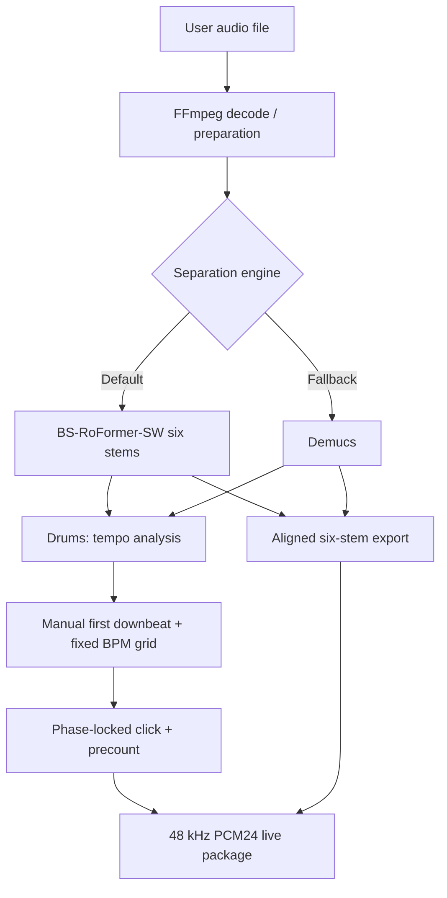

# Architecture — v4.4.1

The GUI is a single Python script (`live_stems_bbeat_v441_roformer_allstems.py`) using CustomTkinter and Matplotlib. Audio processing uses NumPy, librosa, SoundFile and FFmpeg. A constant-tempo beat grid is calibrated against drum transients; the user can correct the first downbeat. Export prepends the same precount to every stem and generates the click from the same time origin.

**Non-goals for this tagged version:** live/real-time source separation, lead/rhythm guitar splitting, cloud/API services, and tempo-map tracking of variable-tempo recordings.
